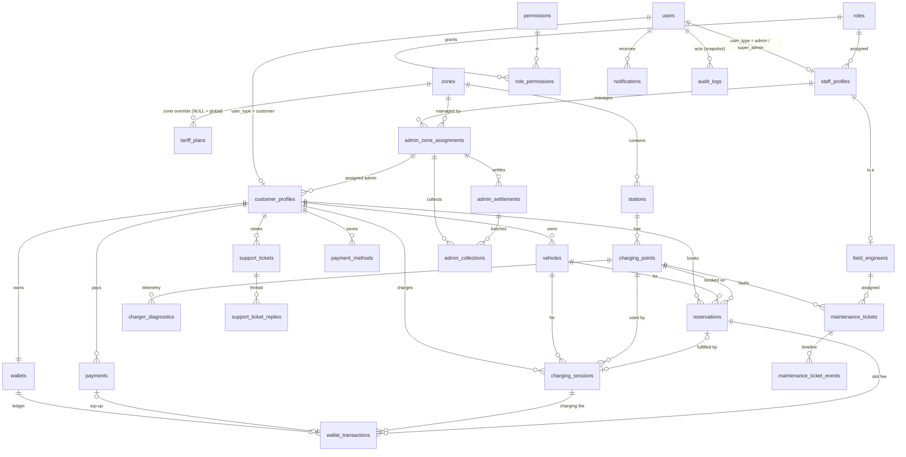

# E-Way Electrical — Database (PostgreSQL)

The relational schema behind the customer, area-admin and super-admin portals in `src/`.
The frontend still runs on demo data; this database is what a backend API should read from and write to.

| File | Purpose |
|---|---|
| [schema.sql](schema.sql) | Tables, enums, constraints, triggers, views (31 tables, 8 views) |
| [seed.sql](seed.sql) | Development data that matches the app's demo data |
| [tests/integrity_tests.sql](tests/integrity_tests.sql) | 42 checks that each relationship rule actually holds; rolls back afterwards |

## Setup

Requires PostgreSQL 15+ (built and tested on 18). Set the password in the environment rather than in a file:

```bash
export PGPASSWORD='<postgres password>'        # PowerShell: $env:PGPASSWORD = '<postgres password>'
psql -h localhost -U postgres -c "CREATE DATABASE eway_db ENCODING 'UTF8' TEMPLATE template0;"
psql -h localhost -U postgres -d eway_db -v ON_ERROR_STOP=1 -f database/schema.sql
psql -h localhost -U postgres -d eway_db -v ON_ERROR_STOP=1 -f database/seed.sql     # optional
psql -h localhost -U postgres -d eway_db -f database/tests/integrity_tests.sql       # expect 42 passed, 0 failed
```

A backend should read the connection string from `DATABASE_URL` in `.env.local` (git-ignored). Never put it in `.env`, which is committed.
A `@` in the password must be written as `%40` in the URL.

## Entity relationships



Tables not in the diagram: `otp_requests`, `user_sessions`, `system_settings`.

## Modelling decisions

- **Zones = Areas.** The admin portal's "Zones" and the super-admin portal's "Areas" use the same codes (`AP-Z01`…), so they are one `zones` table.
- **One `users` table, two profile tables.** Every login lives in `users`. `customer_profiles` and `staff_profiles` hold the type-specific fields. A composite FK on `(user_id, user_type)` means a customer profile can only attach to a customer user, and a staff profile only to an admin or super admin.
- **Admin ↔ zone is many-to-many** (`admin_zone_assignments`). For example, ADM-AP01 manages AP-Z01 and AP-Z08. Assignments are deactivated, never deleted, so financial history keeps a valid reference.
- **Counters are views, not columns.** `totalChargers`, `availableChargers`, `walletBalance`, `sessionsCount`, `activeJobs`, `slaBreached`, `userCount` and similar UI fields come from the `v_*` views, so they can never drift out of sync.
- **Prices are snapshotted.** Reservations and sessions store the `rate_per_kwh` in force when they were created, so a later tariff change does not rewrite history.
- **UI values are normalised.** The UI mixes spellings (`'Success'`/`'successful'`, `'CAR'`/`'Car'`, `'Online'`/`'Active'`). The database uses one lowercase enum per concept, and the API maps between them.
- **No card data.** `payment_methods` stores only the brand, last 4 digits, expiry and a gateway token, never the full number or CVV.

## Rules enforced by the database

| Rule | Mechanism |
|---|---|
| A reservation or session can only use a vehicle the customer owns | Composite FK `(vehicle_id, customer_id) → vehicles(id, owner_id)` |
| A session can only redeem the same customer's reservation | Composite FK `(reservation_id, customer_id)` |
| Wallet entries, payments and collections belong to the right customer | Composite FKs on `customer_id` |
| A charger cannot be double-booked; a vehicle cannot hold overlapping bookings | `EXCLUDE USING gist` on `tstzrange` |
| One live session per charger and per vehicle | Partial unique indexes |
| No booking or session on a charger in maintenance or offline | Trigger `fn_check_bookable` |
| Charger status follows its live session (charging → available, or maintenance if faulted) | Trigger `fn_sync_charger_status` |
| Every customer gets exactly one wallet | Trigger on `customer_profiles` insert |
| The wallet balance changes only through the ledger and never goes negative; posted entries are immutable (correct them with a reversal) | Triggers `fn_wallet_post_transaction` and `fn_wallet_guard_balance` |
| A customer's assigned admin must manage that customer's zone | Composite FK `(assigned_admin_id, zone_id) → admin_zone_assignments` |
| Collections and settlements must be in a zone the admin is assigned to; a collection can only join that admin's own settlement batch | Composite FKs |
| Settlement periods for one admin and zone never overlap | `EXCLUDE` on `daterange` |
| Active tariffs with the same zone, vehicle type and priority never overlap in dates | `EXCLUDE` on `daterange` |
| A field engineer must hold `ROLE_FIELD_ENGINEER` | Trigger |
| Protected roles cannot be edited; audit logs are append-only | Triggers |
| Zones with stations, and chargers with session history, cannot be deleted | `ON DELETE RESTRICT` |

## Seed data

The seed loads 8 zones (AP-Z01…AP-Z08), 8 stations, 32 charging points, 25 permissions, 5 roles, 17 staff and 8 customers. It also includes vehicles, tariffs, a top-up, a completed session and a live one, a reservation, settlements, collections, maintenance tickets, a support ticket, notifications and audit logs.

Development-only logins: super admin `superadmin@ewaytoyourevs.in` / `SuperAdmin@2026!`; all other staff use `Admin@2026!`. Change these before using the database anywhere shared.

The demo data contradicts itself in two places, so the seed resolves them:
- AP-Z07 and AP-Z08 have different names in the admin and super-admin demo files. The seed uses the admin names.
- Area admin ADM-AP05 and field engineer ENG-101 share the name and email "K. Venkatesh". The seed gives the admin the email `venkatesh.kumar@powergrid.in`.

## Not modelled

The FAQ content, the landing-page marketing copy, the AI assistant (it keeps no history) and generated report files are not stored. Report exports are recorded in `audit_logs`.
